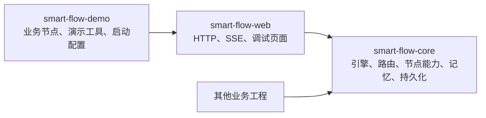
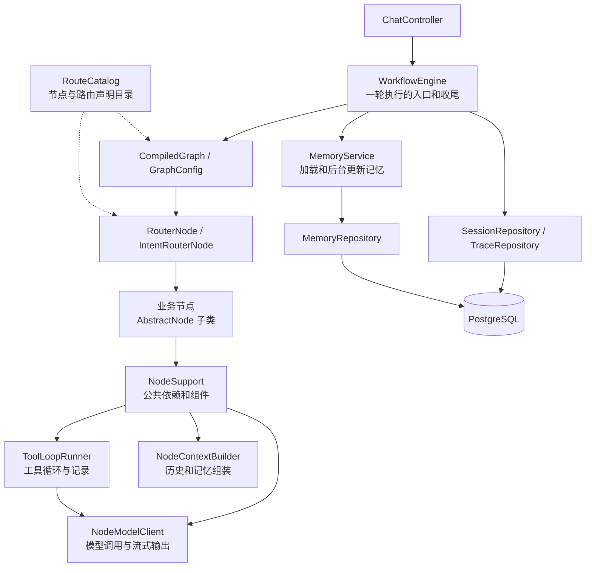
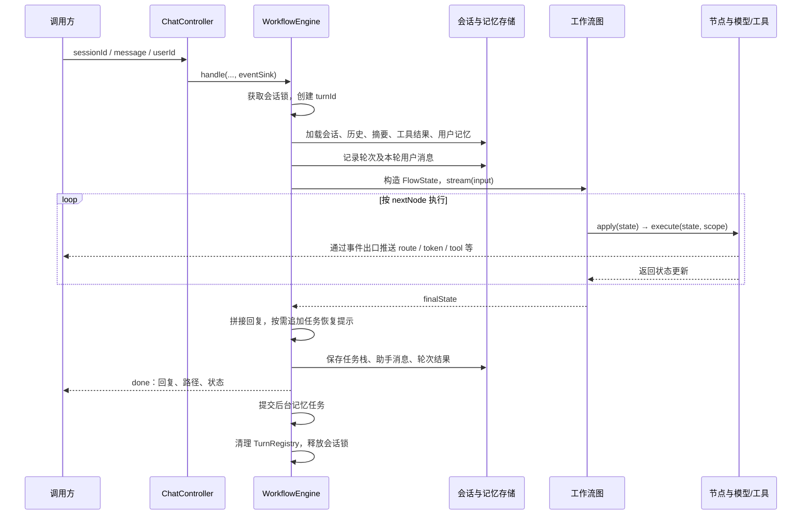
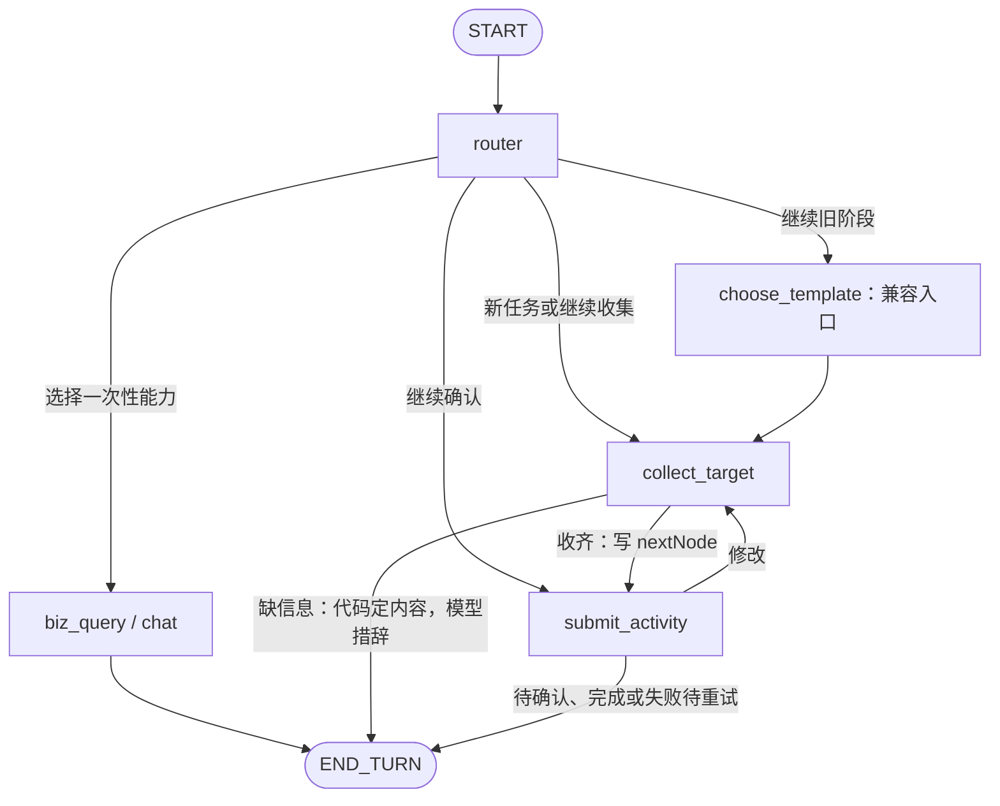
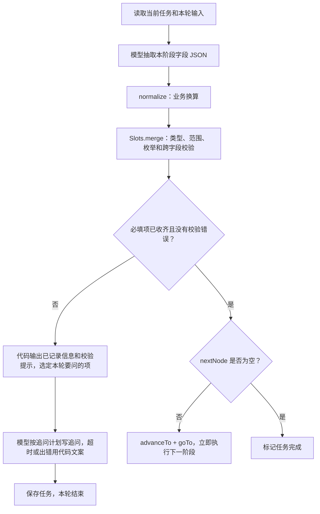
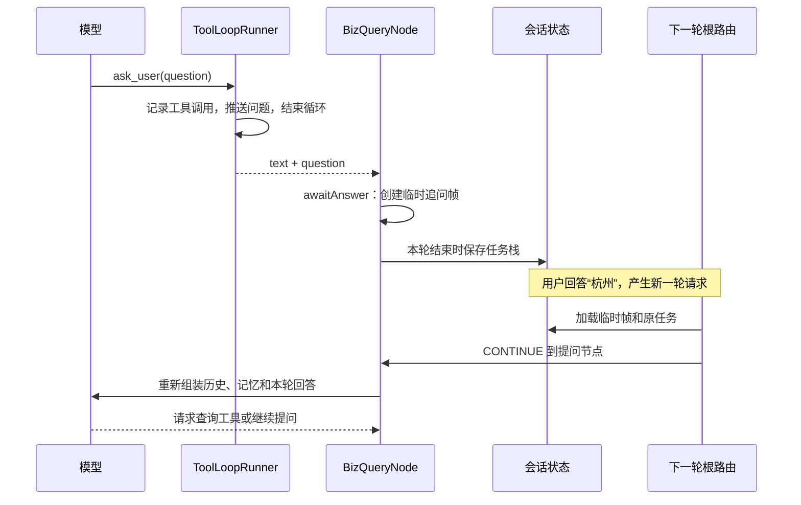

# smart-flow 架构与对话流转

> 当前可运行 Demo 是“短信活动收集组（`SlotGroupNode`）+ 四个无序的 `SlotFillingNode` 成员 + 最终确认提交”，开发请先看 [短信活动说明](sms-activity.md)。本文的旧版顺序活动示例用于讲解框架机制，其 `CollectTargetNode`、`ChooseTemplateNode`、`SubmitActivityNode` 实现已移到 `src/test/java`，不参与运行时注册。

本文面向第一次阅读项目的开发者，说明当前实现的职责划分、状态保存方式和执行路径。示例采用 `smart-flow-demo` 的智慧民生工作流，并包含 `AbstractNode` 拆分后的组件设计。

建议先读第 1～5 节建立整体认识，再结合第 10 节的完整对话理解跨轮流转，最后按第 14 节的顺序阅读源码。搭建新业务的具体代码见 [新工作流接入指南](new-workflow.md)。

## 1. 项目设计

smart-flow 是一个可复用的多节点对话工作流框架。它把自然语言交互拆成几个相互配合的部分：

| 部分 | 做什么 | 例子 |
|---|---|---|
| 模型 | 理解意图、抽取信息、生成自然语言、提出工具调用请求 | 判断“女性”是在补充活动目标人群 |
| 路由代码 | 将模型的判断转换成实际节点、控制任务栈 | 继续当前任务，或者暂时去查天气 |
| 业务节点 | 声明本阶段规则，产出状态更新 | 收集目标人群、选择模版、确认创建 |
| 图执行器 | 按节点返回的 `nextNode` 执行后续节点 | 收齐目标人群后同一轮进入模版选择 |
| 引擎与存储 | 管理轮次、加载与保存状态、记录执行、推送事件 | 下一条消息到来时恢复未完成任务 |

设计上的核心约定是：**模型提供语义判断和候选信息，代码校验并执行状态变化。**

例如模型输出 `CONTINUE + ACTIVITY_CREATE` 后，代码读取任务帧里的当前节点；模型抽取出年龄上下限后，代码验证范围和上下限关系；执行创建操作前，还需要确认节点明确判断用户已经同意。

理解整个项目时，先记住三个事实：

1. **一条用户消息对应一轮执行。** 每轮都从 `START → router` 开始，最后到 `END`。
2. **一轮可以经过多个节点。** 一个活动创建任务也可以跨越多轮。
3. **跨轮恢复依靠数据库中的任务栈。** 当前没有用 LangGraph4j checkpoint 挂起图来等待用户。

## 2. 模块与组件

### 2.1 Maven 模块



箭头表示依赖关系。`smart-flow-web` 传递依赖 core；不需要 HTTP 的业务工程可以直接调用 core 中的 `WorkflowEngine`。

| 模块 | 主要内容 | 边界 |
|---|---|---|
| core | 图组装、任务流转、通用节点、模型与工具调用、记忆、MyBatis 存储 | 提供跨业务复用的机制 |
| web | `ChatController`、`NodeController`、`MemoryController`、静态测试页面 | 接收请求，展示执行和状态 |
| demo | 活动创建、闲聊、业务查询、天气和个人信息工具 | 提供可运行的业务样例 |

当前技术版本由根目录 [pom.xml](../pom.xml) 管理：Java 21、Spring Boot 3.5.7、LangChain4j 1.19.0、LangGraph4j 1.8.27、MyBatis Spring Boot Starter 3.0.5，持久化使用 PostgreSQL。

### 2.2 运行时组件



图中省略了部分持久化依赖：节点生命周期会写 trace，工具循环会写工具记录，模型 listener 会写模型记录。

### 2.3 `AbstractNode` 拆分后的职责

| 类 | 负责什么 | 主要入口 |
|---|---|---|
| `AbstractNode` | 节点声明、执行生命周期、默认结束本轮、追问状态、子类便捷入口 | `apply`、`execute`、`awaitAnswer`、`closeAwait` |
| `NodeSupport` | 汇集公共依赖，创建并复用下面三个组件 | `modelClient()`、`toolLoopRunner()`、`contextBuilder()` |
| `NodeModelClient` | 调用追踪上下文、普通调用、JSON 解析重试、流式 token 输出 | `chatJson`、`streamChat`、`streamReply` |
| `ToolLoopRunner` | 挂载工具、执行多轮调用、工具落库、识别 `ask_user` | `run` |
| `NodeContextBuilder` | 历史窗口选择、消息转换、记忆块组装 | `window`、`toChatMessages`、`memoryBlock` |
| `ToolDescriptions` | 将工具定义渲染成调试页面使用的说明 | `describe` |

三个组件由 `NodeSupport` 构造，当前没有各自注册成 Spring Bean。调用过程中的消息列表、文本缓冲等数据保存在方法局部变量里，可以跨节点复用组件实例。

子类仍调用 `chatJson(...)`、`streamReply(...)`、`streamWithTools(...)` 等基类入口。基类委托时保留了 `chat`、`traceOptions`、`historyPolicy`、`window` 的覆盖行为；原有的 `AbstractNode.LlmJsonException` 捕获方式也保留。

## 3. 启动时如何组装工作流

框架通过 Spring Boot 自动配置接入业务工程：

1. `FlowCoreAutoConfiguration` 注册 core 的组件、`flow.*` 配置和框架自己的 MyBatis Mapper。
2. 业务工程扫描自己的 `@Component` 节点与工具。
3. `RouteCatalog` 汇集全部 `AbstractNode`，读取各节点的 `routeSpec()`。
4. `GraphConfig.build()` 校验配置，注册图节点与条件边，编译成 `CompiledGraph<FlowState>`。
5. Servlet Web 环境中，`FlowWebAutoConfiguration` 注册 HTTP 与调试接口。

`RouteCatalog` 延迟读取节点列表，避免“路由目录需要全部节点，而路由节点又需要路由目录”的构造循环依赖。它生成快照并缓存，提供父路由的可选意图、任务名称、节点存在性等查询。

启动时会检查节点 ID 重复、同一父路由下意图重复、父节点不存在、兜底节点数量不为一个、任务类型存在多个入口，以及根路由缺失等问题。

节点通过三种 `RouteSpec` 工厂方法声明自己：

| 声明 | 语义 | 示例 |
|---|---|---|
| `oneShot` | 一次性能力；有任务时进入它通常算插话 | `BizQueryNode` |
| `taskEntry` | 多轮任务入口；进入时创建或恢复任务 | `CollectTargetNode` |
| `fallback` | 当前父路由的兜底能力 | `ChatNode` |

任务中间阶段通常不声明 `routeSpec()`。它们仍是图节点，但不会成为根路由可直接选择的意图，例如 `submit_activity`；`choose_template` 仅为旧会话保留兼容入口。

新增业务节点后，路由提示词中的能力清单来自它的声明，无需手工修改根路由的提示词和图中的分支列表。这个发现过程发生在容器启动和目录快照构建时，不代表可以任意在线上传 Java 类。

## 4. 状态设计：哪些数据保存多久

### 4.1 四种上下文

| 对象 | 生命周期 | 保存在哪里 | 主要内容 |
|---|---|---|---|
| `FlowState` | 一轮图执行 | 图执行中的状态 | 本轮输入、历史与记忆、任务栈、路由、`nextNode`、回复片段 |
| `SessionState` | 跨轮 | `flow_session.state` JSONB | 当前只保存任务栈 `taskStack` |
| `TurnContext` | 一轮运行时 | `TurnRegistry` 中 | SSE 事件出口、节点路径、执行序号、路由决策、回复分隔标记 |
| `NodeScope` | 一次节点执行 | 方法参数 | `TurnContext`、`execId`、`nodeId` |

`FlowState` 中的数据需要满足图执行过程的序列化要求。事件发送器等运行时对象放在 `TurnContext`，节点通过 `turnId` 找到它。

### 4.2 `FlowState` 的更新方式

节点返回 `Map<String, Object>`，只放需要更新的字段，由图合并到状态中。

- `REPLIES` 使用追加语义，保留同一轮各节点产出的多个回复片段。
- 其余字段默认覆盖，包括 `TASK_STACK`、`ROUTE`、`NEXT_NODE`。
- `AbstractNode.apply()` 每次都会补上默认的 `NEXT_NODE = END_TURN`，避免沿用上个节点留下的去向。

任务帧里的对象先复制再修改。任务阶段节点通常使用 `TaskStackEdit`，最后 `writeTo(updates)` 将整个栈写回。

### 4.3 `nextNode` 与 `currentNode`

这是理解流转最重要的区别：

| 字段 | 位置 | 回答的问题 |
|---|---|---|
| `nextNode` | `FlowState` | 本轮这个节点执行完，马上去哪里？ |
| `currentNode` | `TaskFrame` | 这个任务停在哪个阶段，下次继续时去哪里？ |

例如从目标人群推进到模版选择：

```java
TaskStackEdit edit = editTasks(state);
edit.advanceTo("submit_activity");    // 记录任务当前阶段，并清除旧 awaiting
edit.writeTo(updates);                // 将复制后修改的任务栈写回
goTo(updates, "submit_activity");    // 本轮立即执行下一阶段
```

只修改 `currentNode` 不会让本轮自动跳转；只修改 `nextNode` 又无法正确记录下轮的恢复位置。通用阶段节点负责配套完成这两步。

### 4.4 任务帧

`TaskFrame` 表示一项任务，包含：

| 字段 | 含义 |
|---|---|
| `taskId` | 任务实例 ID；同一个任务执行写操作时作为稳定的幂等键 |
| `taskType` | 任务类型或临时追问所属意图，例如 `ACTIVITY_CREATE`、`BIZ_QUERY` |
| `currentNode` | 当前停留的节点 |
| `status` | `ACTIVE`、`DONE`、`CANCELLED` |
| `slots` | 已收集的结构化业务数据，多个阶段共享同一个 Map |
| `ephemeral` | 是否为一次性节点追问产生的临时帧 |
| `awaiting` | 正在等用户回答什么，供下一轮路由理解上下文 |

列表最后一个元素是栈顶。`activeTask()` 找最靠近栈顶的活动正式任务，跳过临时帧；`pendingQuestion()` 检查栈顶的活动临时帧。轮末保存时，只保留 `ACTIVE` 帧。

## 5. 一条用户消息的完整执行过程

两种入口走同一个 `WorkflowEngine.handle(...)`：

| 接口 | 返回方式 |
|---|---|
| `POST /api/chat` | 等待本轮结束，返回 `TurnResult` |
| `POST /api/chat/stream` | SSE 推送过程事件，最终发送 `done` |

请求包含 `sessionId`、`message`，以及可选的 `userId`。会话首次提供用户标识时绑定，后续请求可以沿用已绑定的用户；长期记忆按这个用户读取。



具体顺序中有几个值得留意的地方：

1. **先加载历史，再写入本轮用户消息。** 因此节点使用 `historyMessages(state)` 后，还会显式加入 `state.userInput()`，不会把当前输入重复放两遍。
2. **同一会话使用 `tryLock()`。** 上一条尚未处理完成时，新请求会被拒绝；不同会话可以并行。
3. **`apply()` 包裹每个节点的业务执行。** 它记录节点开始、结束、异常和耗时，具体业务写在 `execute()`。
4. **流式 token 是执行过程中发出的。** `done` 则在会话状态和本轮结果保存后发出。
5. **后台记忆不属于图内业务节点。** 成功轮次结束时提交到虚拟线程执行器，用户无需等待摘要和长期记忆抽取完成。

## 6. 图如何决定去向

### 6.1 所有节点共用一条规则

`GraphConfig` 没有为每个业务手写大量条件边。它注册全部节点后，让每个节点执行完都读取 `state.nextNode()`。



图展示的是可能的业务路径。实际运行中，这些箭头都通过相同的 `nextNode` 条件边实现。目标 ID 不存在时会报错。

`END_TURN` 是框架使用的结束标记，映射到图的 `END`。结束本轮只表示这次图执行结束，任务是否结束要看任务帧状态。

### 6.2 路由：模型分类，代码计算目标

根路由 `RouterNode` 继承 `IntentRouterNode`。路由会把这些内容交给模型：

- 子节点声明的意图、描述和示例；
- 当前正式任务的类型、阶段、已收集槽位，以及等待确认的内容；
- 从任务入口到当前阶段的可修改字段编码、中文说明，以及尚待提供新值的修改项；
- 临时追问来自哪个节点、问了什么；
- 最近历史、摘要和本轮用户输入。

模型返回约定的 JSON：

```json
{"action":"CONTINUE","intent":"ACTIVITY_CREATE","editSlots":[],"reason":"用户在补充活动信息"}
```

这里没有让模型输出最终节点 `target`。`IntentRouterNode.resolve()` 根据路由目录、当前任务和临时追问计算它。

| 动作 | 代码如何处理 |
|---|---|
| `START` | 去匹配的能力；如果是新的任务入口，创建任务帧压栈 |
| `CONTINUE` | 返回正式任务的 `currentNode`；有合法 `editSlots` 时回到字段所属的收集阶段；也可以返回正在等待回答的追问节点 |
| `DIGRESS` | 一次性查询/闲聊保留原任务，处理后可以提示继续 |
| `CANCEL` | 清掉临时追问，取消当前正式任务；没有正式任务时仅取消追问，结束本轮 |

这些值是输入信号，代码还会纠正不适用的判断：没有任何任务或追问时，`CONTINUE / DIGRESS / CANCEL` 会按开始新话题处理；命中同类任务入口时会继续已有任务，不重复创建。

`editSlots` 只接受当前任务已到达阶段声明的持久化槽位，不接受任意节点名、其他任务的字段或只抽取不保存的辅助字段。
`RouteCatalog.taskSlotStages()` 沿入口收集节点的 `nextNode()` 查找阶段，代码根据字段归属决定修改去向。

模型输出经过 JSON 解析纠错重试后仍不可用时，优先回到待回答的追问节点，其次继续已有任务，最后去兜底能力。输出能解析但意图不认识时，按兜底意图参与后续决策。模型服务调用本身失败则可能上抛为本轮错误，和“输出无法解析”是不同路径。

## 7. 多轮任务：收集、推进、确认

### 7.1 信息收集节点

`SlotFillingNode` 把一个阶段的通用流程固定下来：



模型只抽取本轮明确提及的信息，代码控制合并：普通 `null` 表示没有提供新值，保留原值；显式清空使用 `Slots.CLEAR`；类型或业务校验失败的字段不会覆盖旧值。

`CollectTargetNode` 统一声明六个保存字段：年龄下限、年龄上限、性别、区域、活动模版和活动时间。
年龄上下限属于“年龄范围”必填组，提供任意一端即可；`ageUnlimited` 仅用于抽取和换算，不保存。
它还负责年龄不限换算、单边年龄范围替换和上下限联合校验。

同一轮输入只抽取一次全部活动字段，所以即使年龄和性别还没提供，用户先说的模版、时间也能立即保存。
收齐后直接进入 `submit_activity`。`ChooseTemplateNode` 不再收集信息，只把旧会话转到统一收集节点。
`previousStageIds()` 声明接替的旧阶段，路由目录据此识别旧任务的可修改字段，不需要修改数据库记录。

追问拆成两部分，“说什么”始终由代码决定：

1. **事实**：本轮保存了什么（来自校验合并后的 `task.slots`）、哪里填得不对（`SlotErrors` 的原因），由代码拼好立刻输出。
2. **追问**：优先处理校验错误和待修改项，其次询问缺失必填项，按声明顺序每轮最多两项（同组只问一次），枚举选项来自 `SlotSpec`。
   `flow.slot-filling.ask-mode=model`（默认）时，代码把追问计划（本轮要问的项、之后还要了解的项、需要重新提供的原因、
   是否连续问了同一个问题）交给 `ask_missing` 模型措辞并流式输出，它能回应“我再想想”“你推荐一个”这类话；
   追问模型拿不到已收集的信息，被要求不复述、不确认，从源头上避免确认没保存的内容。
   首字超过 `first-token-timeout-ms`（默认 2000 毫秒）、出错或没有输出时，改用代码文案（例如“请补充：年龄范围、性别。”），
   放弃之后模型迟到的输出会被丢弃；输出一半断开时保留已发出的半句，另起一行补上代码文案。`ask-mode=code` 时不调用模型。

`task.awaiting` 始终记代码文案：下一轮路由靠它判断用户在回答什么，节点也用它发现同一个问题被连续问了两次，提示模型换个说法。
因为追问内容由代码选定，不会自行增加人数、名称，也不会在“下周六上午”已保存后强制追问起止时刻。

几项信息没有先后顺序时，用 `SlotGroupNode` 把多个 `SlotFillingNode` 组成无序组：组节点用全部成员的槽位抽取一次，
本轮提到的成员各自 `collect`（校验合并 + `afterMerge`），然后统一追问或推进；追问规则（`SlotAsk`）和单个收集节点共用。
`RouteCatalog.taskSlotStages` 把组成员算作同一阶段，修改成员字段时 `editEntry` 让任务回到组节点。

框架仍支持多个收集阶段。自动推进的节点不发送中间确认，把本轮有变化的信息暂存在 `FlowState.collectedStageInfo`（不写入会话）。
后续追问的事实部分由代码合并这些已保存信息；一路进入 `ConfirmNode` 时只展示完整清单。`completedText()` 只在没有下一阶段、收齐即完成任务时调用。

用户说“我想修改区域”时，路由把 `region` 加入 `editingSlots`，回到 `collect_target`。
旧值暂时保留，待有效新值通过校验才替换并清除待修改标记；空值、无效值或抽取失败都继续等待。
待修改状态跨轮和插话保存，修改完成后重新展示汇总等待确认。

### 7.2 确认节点与写操作

`ConfirmNode` 将确认和实际写操作分开：

| 当前情况 | 行为 |
|---|---|
| 第一次进入，任务还没有 `awaiting` | 展示汇总，记录等待确认，结束本轮 |
| 用户明确确认 | 调用子类 `commit(task, taskId)` |
| 用户提供了具体修改内容 | 回到 `editNode()`，本轮立即执行修改阶段 |
| 用户只说“有地方要改” | 询问要改哪项，继续等待 |
| 用户取消 | 标记任务取消 |
| 不能明确判断，例如仅说“继续” | 再展示确认内容 |
| `commit` 返回失败或抛异常 | 保留待确认状态，提示可以重试 |

明确确认词先走代码判定，其他表达再用模型分类。修改后推进回来时，`advanceTo()` 已清掉原来的 `awaiting`，所以会重新展示汇总请求确认。

`taskId` 在任务存活期间保持不变，作为 `commit` 的幂等键。接真实业务系统时，子类需要用请求号或数据库唯一约束落实去重：外部写成功后，后续步骤仍可能失败，用户重新确认时会再次进入 `commit`。

当前 demo 的 `SubmitActivityNode` 只根据幂等键生成固定活动编号并返回成功，没有调用真实活动系统；天气和个人信息工具也返回演示数据。

## 8. 工具查询与 `ask_user`

### 8.1 普通工具循环

工具实现 `FlowTool`，包含显式的 `ToolSpecification` 和 `execute(arguments, ToolContext)`。节点持有自己的工具列表，调用 `streamWithTools()`。

`ToolLoopRunner` 的处理顺序：

1. 注册业务工具，自动加入内置 `AskUserTool`。
2. 将消息和工具定义发送给流式模型，文本 token 同步推给前端。
3. 如果模型给出普通回答，返回本节点累计文本。
4. 如果模型提出工具调用，逐个执行、记录参数和结果，再把 AI 工具请求及对应结果追加到当前消息列表。
5. 再请求模型，让它根据结果回答或继续调用工具。

`BizQueryNode` 当前最多允许 4 轮模型循环；同一次响应中的普通工具按顺序执行。超出轮数时发送固定兜底文案并结束。工具不存在或执行抛异常时，通常会记录为 `ERROR`，并将错误作为工具结果返回模型，由模型继续处理。

### 8.2 为什么提问也要定义成工具

普通回复里出现问号，并不能可靠表示节点必须等待用户补充参数。`ask_user` 用结构化的工具调用表达这个意图，例如：

```json
{"question":"请问要查哪个城市的天气？"}
```



`AskUserTool.execute()` 的返回值用于工具记录；真正控制本轮结束的是工具循环，真正记录等待状态的是节点的 `awaitAnswer()`。下轮恢复时会重新执行节点与模型调用，不会恢复上轮的 Java 调用栈，也不会直接从原工具执行处接着跑。

`BizQueryNode` 拿到结果后：

- `result.asked()` 为 true：保存临时追问帧，或者更新为新问题。
- 没有新追问：调用 `closeAwait()` 清掉临时帧。

如果模型在同一响应里既调用 `ask_user` 又调用其他工具，当前实现优先处理提问，忽略其他工具。工具描述中的“提问时不要同时输出正文”是给模型的约束，运行时仍有正文与问题参数的兼容处理。

正式任务中的槽位追问和确认，使用正式任务的阶段、槽位和 `awaiting` 恢复；临时追问帧主要解决一次性工具节点缺参数的问题，两种等待状态需要区分。

## 9. 插话、临时追问与任务栈

假设正在选择活动模版与时间，用户突然查天气，但还没提供城市。任务栈可以是：

```text
栈顶  [临时追问] BIZ_QUERY       currentNode=biz_query
                awaiting=“请问要查哪个城市？”
      [正式任务] ACTIVITY_CREATE currentNode=collect_target
                slots=已收集的目标人群和模版
栈底
```

下一轮根路由同时看到正式任务和临时追问：

| 用户回复 | 预期语义与处理 |
|---|---|
| “杭州” | 回答临时追问，回到 `biz_query`，原活动任务保留 |
| “先继续活动” | 继续正式任务，丢弃临时追问，回到 `collect_target` |
| “给我讲个笑话” | 开始另一话题，旧临时追问作废，正式任务仍保留 |
| “取消” | 当前规则会清掉临时追问，并取消当前正式任务；只有追问时则只取消追问 |

这些自然语言先由模型分类，表格展示的是对应语义下的代码行为。`CONTINUE` 到底是回答追问还是继续任务，会结合模型给的 `intent` 区分。

一次性插话结束后，引擎根据 `RouteDecision.sideTrip` 判断是否追加“刚才的活动创建还没完成，要继续吗”。如果当前又有一个待回答的临时问题，就先不追加；如果回复已包含任务名和“继续”，也避免重复提醒。

框架还支持新任务压在旧任务上面。新任务完成或取消后，下面的活动任务重新成为 `activeTask()`；它通常由下一轮路由恢复，不会因为出栈就自动在同一轮继续执行旧任务。

## 10. 用一段完整对话看流转

下面展示在意图识别和信息抽取符合预期时的成功路径。假设天气查询没有可直接使用的城市上下文，且每条输入沿用同一个 `sessionId`。

| 轮次 | 用户输入 | 本轮实际节点路径 | 轮末状态 |
|---|---|---|---|
| 1 | “创建一个敬老活动，面向阳光社区 60 岁以上的人，性别不限” | `router → collect_target` | 人群和敬老模版已保存，缺时间，停在统一收集节点 |
| 2 | “天气怎么样？” | `router → biz_query` | 插话；`ask_user` 问城市，栈顶新增临时帧 |
| 3 | “杭州” | `router → biz_query` | 查天气并回答；临时帧移除，活动任务仍在收集节点，追加恢复提示 |
| 4 | “继续，时间定在下周六上午” | `router → collect_target → submit_activity` | 收齐活动信息，确认节点展示汇总，记录等待确认 |
| 5 | “区域改成幸福社区” | `router → submit_activity → collect_target → submit_activity` | 确认节点判断为修改；收集节点改区域，已有信息仍满足要求，推进回来重新确认 |
| 6 | “确认” | `router → submit_activity` | 调用 demo 的创建逻辑，任务标记完成，轮末出栈 |

轮次 2 结束后的会话状态大致如下，ID 为示意值：

```json
{
  "taskStack": [
    {
      "taskId": "activity-task-id",
      "taskType": "ACTIVITY_CREATE",
      "currentNode": "collect_target",
      "status": "ACTIVE",
      "slots": {
        "ageMin": 60,
        "gender": "ALL",
        "region": "阳光社区",
        "template": "ELDERLY_CARE"
      },
      "ephemeral": false,
      "awaiting": null
    },
    {
      "taskId": "question-frame-id",
      "taskType": "BIZ_QUERY",
      "currentNode": "biz_query",
      "status": "ACTIVE",
      "slots": {},
      "ephemeral": true,
      "awaiting": "请问要查哪个城市的天气？"
    }
  ]
}
```

这里能看出：用户的短回复“杭州”不需要包含“查天气”三个字，路由可以利用临时追问帧判断它的含义。活动目标人群又独立保存在正式任务槽位中，查询天气不会替活动修改区域。

## 11. 记忆如何进入模型上下文

### 11.1 从存储到提示词

```text
MemoryService.load(sessionId, userId)
  ├─ 会话滚动摘要
  ├─ 摘要游标之后的最近原文
  ├─ 这些原文所属轮次的成功工具结果（排除 ask_user）
  └─ 用户长期记忆
                  ↓ 放入 FlowState
节点的 HistoryPolicy + NodeContextBuilder
  ├─ historyMessages / historyAsText：选窗口并转换格式
  └─ memoryBlock：按需加入长期记忆、摘要、窗口内的工具结果
                  ↓
              本次模型请求
```

`MemoryService` 负责“读回来什么”，`NodeContextBuilder` 负责“当前节点实际带什么”。任务栈则由引擎从会话状态加载，不依赖模型从摘要里重新推测。

### 11.2 保存位置与用途

| 数据 | 存储 | 范围与用途 |
|---|---|---|
| 正式任务和临时追问 | `flow_session.state` | 会话内的确定性恢复状态 |
| 对话原文 | `flow_message` | 近期对话上下文；原文保留在数据库 |
| 滚动摘要 | `flow_memory_summary` | 会话内较早内容的压缩表示，用 `up_to_message_id` 标记覆盖范围 |
| 用户长期信息 | `flow_user_memory` | 按 `userId` 跨会话复用，同一用户同一 key 更新覆盖 |
| 查询结果 | `flow_tool_call` | 历史窗口内成功查询的事实，支持“那明天呢”这类追问 |

当前 `SessionState` 只包含任务栈，摘要已经放入独立表。建表脚本中的部分早期注释仍提到会话 state 里的摘要，理解当前行为时以 Java 状态类和 Mapper 的实际读写为准。

### 11.3 上下文预算与节点策略

历史窗口同时受消息条数和估算 token 上限约束，从最新往前选取，并按时间正序发送；条数允许时，最新一条即使超过 token 预算也会保留。这是对历史消息部分的预算，不是对整份模型请求的精确 token 限额。

| 节点 | 历史条数 | 摘要 | 长期记忆 | 工具结果 |
|---|---|---|---|---|
| 根路由 | 6 | 是 | 否 | 否 |
| 闲聊 | 默认配置，demo 为 12 | 是 | 是 | 否 |
| 业务查询 | 默认配置，demo 为 12 | 是 | 是 | 是 |
| 槽位收集（抽取、追问） | 只带助手上一句话 | 否 | 否 | 否 |

工具结果还会按实际历史窗口的 `turnId` 再过滤，每条结果当前最多展示 500 个字符。历史已排除的轮次不会仅靠工具结果重新塞回上下文。

### 11.4 后台更新

成功轮次调用 `MemoryService.afterTurn()`，同一个后台任务先尝试更新摘要，再抽取长期记忆，各自捕获异常。

- 摘要超过触发条数后，保留最近原文，将较早消息和旧摘要交给记忆模型合并；返回空摘要时不推进游标。
- 长期记忆抽取产生增删改，再由代码执行持久化；需要启用配置且有有效 `userId`，受最大条数限制。
- 摘要和长期记忆异步产生，下一轮紧接着到来时可能读到更新前的值。
- 摘要使用独立表，避免后台写入被下一轮保存 `SessionState` 覆盖。同一会话的摘要任务在当前进程内做防重入控制。

## 12. 可观测性：回复、节点、模型、工具如何关联

### 12.1 标识层级

```text
sessionId：会话
  └─ turnId：一次用户输入
       └─ execId：一个节点的一次执行
            └─ callId：一次模型调用
                 └─ toolCallId：一次工具执行
```

同一节点可能调用模型多次，例如 JSON 重试、工具循环。`purpose` 区分用途，例如 `route`、`extract_slots`、`confirm_decision`、`answer`、`answer#2`、`reply`。

模型记录由 `TraceChatModelListener` 完成。调用时通过 `ChatRequestOptions.listenerAttributes` 传入会话、轮次、节点执行等标识；流式回调即使换线程，也可以使用这些关联信息。工具循环会预先生成模型 `callId`，使工具记录的 `llm_call_id` 能指向发起调用的那次模型请求。

后台记忆调用关联触发它的 `turnId`，`node_id = memory`，通常没有业务图节点的 `execId`，不能把它误认为图里的一个阶段。

### 12.2 数据表

| 表 | 记录什么 |
|---|---|
| `flow_session` | 绑定用户、任务栈、轮次计数 |
| `flow_message` | 用户原文和最终助手回复 |
| `flow_turn` | 一轮的输入、结果、路由、节点路径、前后状态、耗时与错误 |
| `flow_node_exec` | 每个节点的输入快照、状态更新、执行结果 |
| `flow_llm_call` | 模型请求、响应、token 用量、调用用途、状态与耗时 |
| `flow_tool_call` | 工具名、参数、结果、状态、耗时和模型调用关联 |
| `flow_memory_summary` | 摘要和已覆盖消息的游标 |
| `flow_user_memory` | 用户记忆及来源会话、轮次 |

以上是应用层维护的逻辑关联；当前建表脚本没有声明外键。

执行记录的 SQL 按表拆分：`flow_turn` 对应 `TurnMapper.xml`，`flow_node_exec` 对应 `NodeExecMapper.xml`，`flow_llm_call` 对应 `LlmCallMapper.xml`，`flow_tool_call` 对应 `ToolCallMapper.xml`。每个文件包含该表的写入、更新和查询，Java Mapper 与 XML 同名、同路径；由自动配置注册，`TraceRepository` 统一委托调用。

### 12.3 SSE 事件

| 事件 | 含义 |
|---|---|
| `turn` | 本轮开始，提供 `turnId` 和轮次序号 |
| `node_start` / `node_end` | 节点执行开始和完成 |
| `route` | 最终路由动作、意图、目标、兜底和插话标记 |
| `token` | 实时回复片段，也包括固定文案和分隔符 |
| `tool` | 一次工具执行的参数、结果、状态和耗时 |
| `done` | 成功完成，提供最终回复、节点路径和会话状态 |
| `error` | 处理失败 |

SSE 输出由 `TurnContext` 汇集。不同节点回复之间使用空行，同一工具循环内不同轮文本使用换行；最终助手消息按对应规则拼接，避免前端显示与保存文本出现分隔差异。

客户端断开时，Controller 停止发送事件，当前轮次仍会继续执行和落库；浏览器关闭连接不等于取消业务任务。

调试入口：`GET /api/nodes` 查看注册和提示词，`GET /api/sessions/{sessionId}` 查看会话与轮次，`GET /api/turns/{turnId}` 查看节点、模型和工具记录，`GET /api/sessions/{sessionId}/memory` 查看记忆。

## 13. 失败处理与当前实现边界

| 发生什么 | 当前处理 |
|---|---|
| 同会话请求重叠 | 会话锁冲突，拒绝后来的请求 |
| 模型 JSON 无法解析 | 追加纠错提示重试一次；仍失败由节点决定兜底 |
| 路由 JSON 最终不可用 | 优先恢复待回答追问，其次已有任务，最后兜底能力 |
| 槽位抽取最终失败 | 按本轮没有抽取到新信息处理 |
| 确认分类不可用 | 按不明确处理，重新展示确认 |
| 普通工具不存在或执行失败 | 将错误作为工具结果交回模型，并记录调用错误 |
| 确认后的业务写操作失败 | 保持任务待确认，让用户重试或取消 |
| 图内执行等异常上抛到引擎收尾逻辑 | 尝试恢复本轮前的会话状态，轮次号仍递增，记录错误并发送 `error` |
| 后台记忆处理失败 | 记录日志，不影响已经生成的对话回复 |

“恢复会话状态”是引擎的应用层错误处理。它不能撤销已发出的 token、已写入的用户消息和 trace，也不能撤销外部业务系统已经成功的写入；本轮各类写入没有被一个覆盖全部步骤的大事务统一包住。因此真实业务提交必须实现幂等。

当前会话锁和摘要防重入控制都在单进程内。多实例部署时，还需要共享的并发控制，才能保证同一会话被不同实例处理时的顺序。

SSE 超时配置与模型请求超时是不同层次。模型流式等待使用模型超时加少量缓冲时间；SSE 连接结束不会主动中断正在执行的图。

这些边界解释了为什么项目同时保留任务结构化状态、执行日志和幂等键，也说明了后续扩展需要落在哪一层。

## 14. 建议的源码阅读顺序与扩展位置

按下面顺序读，可以先掌握控制流，再进入模型细节：

| 顺序 | 源码入口 | 重点看什么 |
|---|---|---|
| 1 | [ChatController](../smart-flow-web/src/main/java/com/example/smartflow/web/ChatController.java) | HTTP 请求如何进入引擎，SSE 如何发送 |
| 2 | [WorkflowEngine](../smart-flow-core/src/main/java/com/example/smartflow/engine/WorkflowEngine.java) | `handle`、`doHandle` 的加载、执行、收尾 |
| 3 | [FlowState](../smart-flow-core/src/main/java/com/example/smartflow/flow/FlowState.java)、[TaskFrame](../smart-flow-core/src/main/java/com/example/smartflow/flow/TaskFrame.java) | 图状态、任务阶段、临时追问 |
| 4 | [GraphConfig](../smart-flow-core/src/main/java/com/example/smartflow/config/GraphConfig.java) | `START`、统一条件边、`END_TURN` |
| 5 | [IntentRouterNode](../smart-flow-core/src/main/java/com/example/smartflow/node/route/IntentRouterNode.java)、[RouteCatalog](../smart-flow-core/src/main/java/com/example/smartflow/node/route/RouteCatalog.java) | `classify → resolve` 和声明驱动的路由 |
| 6 | [AbstractNode](../smart-flow-core/src/main/java/com/example/smartflow/node/AbstractNode.java)、[NodeSupport](../smart-flow-core/src/main/java/com/example/smartflow/node/NodeSupport.java) | 节点模板、组件委托和扩展点 |
| 7 | [SlotFillingNode](../smart-flow-core/src/main/java/com/example/smartflow/node/slot/SlotFillingNode.java)、[ConfirmNode](../smart-flow-core/src/main/java/com/example/smartflow/node/confirm/ConfirmNode.java)、[TaskStackEdit](../smart-flow-core/src/main/java/com/example/smartflow/node/TaskStackEdit.java) | 阶段推进、修改回退、确认提交 |
| 8 | [BizQueryNode](../smart-flow-demo/src/main/java/com/example/smartflow/demo/node/BizQueryNode.java)、[ToolLoopRunner](../smart-flow-core/src/main/java/com/example/smartflow/tool/ToolLoopRunner.java)、[AskUserTool](../smart-flow-core/src/main/java/com/example/smartflow/tool/AskUserTool.java) | 工具调用和追问恢复 |
| 9 | [NodeModelClient](../smart-flow-core/src/main/java/com/example/smartflow/llm/NodeModelClient.java)、[NodeContextBuilder](../smart-flow-core/src/main/java/com/example/smartflow/memory/NodeContextBuilder.java)、[MemoryService](../smart-flow-core/src/main/java/com/example/smartflow/memory/MemoryService.java) | 调用、上下文预算和后台记忆 |
| 10 | [WorkflowScenarioTest](../smart-flow-demo/src/test/java/com/example/smartflow/engine/WorkflowScenarioTest.java) | 用模型脚本和内存存储验证完整对话 |

实现新需求时，可以按职责选择入口：

| 需求 | 优先修改的位置 |
|---|---|
| 新增一次性能力 | 新建 `AbstractNode` 子类并声明 `RouteSpec.oneShot` |
| 新增多轮业务 | `taskEntry` 入口 + 若干 `SlotFillingNode` 阶段 + `ConfirmNode` |
| 新增查询工具 | 实现 `FlowTool`，加入目标节点的工具列表，更新路由能力描述 |
| 改字段规则 | `SlotSpec`、`normalize`、`validateTogether` |
| 改确认后的业务写入 | 业务确认节点的 `commit`，实现幂等 |
| 改节点携带的历史和记忆 | 覆盖 `historyPolicy()`；通用规则在 `NodeContextBuilder` |
| 改模型调用与重试 | `NodeModelClient`；特定节点可覆盖保留的调用入口 |
| 改轮次加载、保存或恢复策略 | `WorkflowEngine`、对应 Repository |
| 查看路由为什么走错 | 节点声明与提示词、`route` 事件、`flow_llm_call`、实际任务栈 |

现有场景测试不依赖真实模型或数据库，适合理解预期行为；真实模型是否始终正确识别意图和抽取字段，需要结合实际对话与模型评测验证。新工作流的接入步骤和完整代码示例继续参考 [new-workflow.md](new-workflow.md)。
