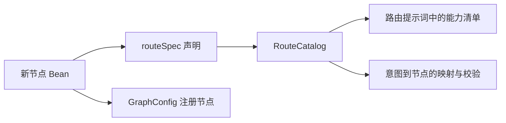

 # smart-flow 源码学习导读：从启动到一轮对话

这份文档面向这样的你：项目已经能跑，但代码主要由 AI 生成，你想真正掌握它，知道对象从哪里来、方法由谁调用、状态如何保存，以及为什么采用这些设计。

不要求你先熟悉 LangGraph4j。需要的 Java、Spring 概念会放在对应代码旁边解释。本文描述的是当前仓库实现；流程图是为了讲清关系，不代表所有对象严格按图上的排列顺序创建。示例模型输出和状态片段会明确标为示意，实际输出要以运行记录为准。

已有的 [架构文档](architecture.md) 适合查阅，[新工作流指南](new-workflow.md) 适合新增业务；本文适合边读边打开源码学习。

## 阅读路线

建议分五次阅读，每次先做完练习，再继续下一组。

| 学习单元 | 章节 | 学完应该能回答 |
|---|---|---|
| 第一次：对象怎么来的 | 1～5 | 为什么 main 只有一行，框架却能加载那么多对象？ |
| 第二次：消息怎么跑 | 6～9 | 谁调用节点？为什么节点返回 Map？下一轮怎么恢复？ |
| 第三次：业务怎么完成 | 10～12 | 怎么收集信息、修改信息、插话、确认提交？ |
| 第四次：模型和存储 | 13～15 | 模型、工具、记忆、日志和数据库怎么串起来？ |
| 第五次：自己验证 | 16～19 | 能否独立跟一条链路、解释设计、定位问题？ |

本文源码链接相对 `docs/` 目录定位。IDE 中点击链接，或用“查找类”输入类名即可；方法名比行号更适合长期定位。

## 1. 先用一句业务话理解项目

用户说：“我想给阳光社区 60 岁以上的女性办一场健康讲座，下周六上午。”

系统要做的事并不是只回复一句话，而是：

1. 判断用户要创建活动。
2. 把年龄、性别、区域、活动模版、时间变成结构化数据。
3. 检查信息是否有效、是否齐全。
4. 展示汇总，请用户确认。
5. 确认后执行提交。
6. 中途允许用户问天气、修改区域、取消任务。
7. 下一条消息到来时，知道刚才进行到哪里。

因此项目同时需要“自然语言理解”和“有规则的流程执行”。

模型负责提出意图判断、候选字段、自然语言回复和工具调用请求；Java 代码负责解释这些结果、校验字段、修改任务状态和执行操作。模型给出的 JSON 也需要检查，不能因为格式正确就认为业务正确。

## 2. 三个模块与三个容易混淆的框架

打开根目录 [pom.xml](../pom.xml)、[demo/pom.xml](../smart-flow-demo/pom.xml) 和 [web/pom.xml](../smart-flow-web/pom.xml)。

```text
smart-flow-parent              聚合构建、统一依赖版本，本身不是业务启动程序
├── smart-flow-core            引擎、节点抽象、路由、记忆、存储、追踪
├── smart-flow-web  → core     HTTP / SSE 接口、调试页面
└── smart-flow-demo → web      业务节点、演示工具、应用启动入口
```

箭头表示 Maven 依赖。demo 依赖 web，web 依赖 core，因此 demo 运行时能使用 core 的类。父工程的 `<modules>` 是构建清单，本身不会让 Spring 自动扫描模块。

| 技术 | 在本项目里做什么 | 不要误认为 |
|---|---|---|
| Spring Boot / Spring | 启动应用、注册对象、注入依赖、接收 HTTP 请求 | 它理解业务意图并决定下一节点 |
| LangChain4j | 提供模型客户端、消息类型、流式回调、工具协议等 | 模型会直接执行你机器里的 Java 方法 |
| LangGraph4j | 按图规则调度节点、合并节点返回的状态更新 | 它自动替本项目保存所有跨轮会话 |
| MyBatis | 把 Mapper 接口调用映射到 SQL，处理参数和结果 | Mapper 接口需要你手写一个实现类 |

**这个分层好在哪里？** 另一个业务可以复用 core；需要 HTTP 就再依赖 web。活动创建的年龄规则不必进入通用引擎。

**边界在哪里？** core 目前也包含 MyBatis 存储和模型配置，并不是一个完全不依赖基础设施的纯算法库。理解“框架与业务分开”时，不要扩大成“所有基础设施都可无缝替换”。

## 3. “类如何加载”其实有三层问题

### 3.1 JVM 加载类：让程序认识一个类型

Java 源文件编译成 `.class`。运行应用时，JVM 的类加载机制根据需要从运行时类路径中的目录或 JAR 读取类定义，再经历链接、初始化等过程。

“存在这个类”和“已经创建这个类的对象”是两件事。类初始化中的静态初始化，也不同于每次 `new` 时执行实例构造器。第一次读项目，不必背 JVM 所有阶段；先记住：**类是类型，对象是实例，Bean 是交给 Spring 管理的对象。**

本项目没有实现自己的插件 ClassLoader，也没有在线上传 Java 类并自动热加载的机制。

### 3.2 Spring 注册和创建 Bean：让对象相互协作

Spring 先处理配置和扫描结果，得到 Bean 定义，可以理解为“对象该怎么创建的说明”。随后根据依赖关系创建对象，把需要的其他 Bean 传给它。

例如一个构造器需要 `NodeSupport`，Spring 就会解析对应依赖。通常默认单例 Bean 在容器启动期间创建；延迟获取等机制会改变获取时机。**不要把所有 Bean 的创建顺序理解成文件顺序、包名顺序或继承顺序。**

### 3.3 工作流注册节点：让图知道可以执行哪些对象

一个类变成 Spring Bean 之后，还要符合工作流的节点类型，才能被收集到 `List<AbstractNode>`，再注册到图里。

```text
类可被运行时使用
    ↓ Spring 扫描 / @Bean 等注册方式
Spring 管理的对象
    ↓ 按 AbstractNode 类型收集
工作流节点集合
    ↓ GraphConfig.build
图里的 nodeId → 节点对象
```

三个过程由不同机制完成。理解它们后，“新增一个类为什么没生效”就有了排查顺序：依赖是否可见 → 是否注册 Bean → 是否属于节点类型 → 图和路由声明是否正确。

## 4. 从 main 开始，跟完 Spring 的装配链

### 4.1 应用入口只负责启动容器

打开 [SmartFlowApplication.java](../smart-flow-demo/src/main/java/com/example/smartflow/demo/SmartFlowApplication.java)，看 `main`：

```java
SpringApplication.run(SmartFlowApplication.class, args);
```

入口位于 `com.example.smartflow.demo`。这里的 `@SpringBootApplication` 开启应用配置、自动配置和默认组件扫描。默认扫描范围是启动类所在包及其子包，因此 demo 的 `node`、`tool` 能被发现。

**疑问：core 和 web 不在 demo 子包下，为什么也能被发现？** 通过下面的自动配置入口。

### 4.2 自动配置不是靠“依赖里的所有类都扫描一遍”

打开两个资源文件：

- [core 的 AutoConfiguration.imports](../smart-flow-core/src/main/resources/META-INF/spring/org.springframework.boot.autoconfigure.AutoConfiguration.imports)
- [web 的 AutoConfiguration.imports](../smart-flow-web/src/main/resources/META-INF/spring/org.springframework.boot.autoconfigure.AutoConfiguration.imports)

它们分别列出 `FlowCoreAutoConfiguration` 和 `FlowWebAutoConfiguration`。Spring Boot 通过这些约定资源发现自动配置候选类，这是依赖 JAR 接入框架的入口。[Spring Boot 3.5 官方说明](https://docs.spring.io/spring-boot/3.5/reference/features/developing-auto-configuration.html)

继续打开 [FlowCoreAutoConfiguration.java](../smart-flow-core/src/main/java/com/example/smartflow/autoconfigure/FlowCoreAutoConfiguration.java)：

| 当前代码 | 作用 |
|---|---|
| `@AutoConfiguration(after = MybatisAutoConfiguration.class)` | 声明自动配置处理顺序 |
| `@EnableConfigurationProperties(FlowProperties.class)` | 注册并绑定 `flow.*` 配置对象 |
| `@ComponentScan(basePackages = {...})` | 当前项目显式扫描框架的 config、engine、node、memory 等包 |
| Mapper 相关 `@Bean` 方法 | 将 MyBatis Mapper 代理作为 Bean 暴露 |

`after` 影响配置定义处理顺序，不等于“前一个配置的所有对象都创建完，才能创建后一个配置的对象”。实例创建仍受依赖关系影响。[官方顺序语义](https://docs.spring.io/spring-boot/3.5/reference/features/developing-auto-configuration.html)

这里也要区分“现有实现”和“通用最佳实践”：当前自动配置使用组件扫描；Spring Boot 官方更建议自动配置通过明确的 `@Import` 引入组件。本文解释现状，不把现有的每种写法都当成唯一正确方式。

再打开 [FlowWebAutoConfiguration.java](../smart-flow-web/src/main/java/com/example/smartflow/autoconfigure/web/FlowWebAutoConfiguration.java)：它只在 Servlet Web 应用条件下生效，并扫描 `com.example.smartflow.web`，因此 Controller 会进入容器。

### 4.3 构造器注入：依赖由 Spring 传入

打开 [CollectTargetNode.java](../smart-flow-demo/src/main/java/com/example/smartflow/demo/node/CollectTargetNode.java)：

```java
public CollectTargetNode(NodeSupport support) {
    super(support);
}
```

这表示创建节点需要一个 `NodeSupport`。Spring 查找该类型的 Bean，再调用构造器。单一构造器通常不必额外标 `@Autowired`；本项目 `NodeSupport` 有多个构造器，供 Spring 使用的那个明确标了 `@Autowired`。[Spring 构造器注入说明](https://docs.spring.io/spring-framework/reference/core/beans/annotation-config/autowired.html)

`super(support)` 是普通 Java 父类构造器调用。创建一个 `CollectTargetNode` 对象时，会初始化它的父类部分；这不意味着 Spring 又独立创建了一个 `SlotFillingNode` 或 `AbstractNode` Bean。

**好处：** 依赖能从构造器直接看见；测试可以自己 `new` 对象并传入替代依赖，不必每次启动 Spring。

### 4.4 对象来源对照表

| 对象 | 谁创建 / 注册 | 生命周期上的理解 |
|---|---|---|
| `CollectTargetNode`、`ChooseTemplateNode` 等 | demo 扫描 `@Component` | 默认是容器单例，多个会话共用节点实例 |
| `RouterNode`、`NodeSupport`、`WorkflowEngine` 等 | core 自动配置的扫描 | 默认是容器单例 |
| `FlowProperties` | 配置属性绑定 | 把配置值转换成 Java 配置对象 |
| `ModelRegistry` | `ModelConfig.modelRegistry()` 的 `@Bean` 方法 | 持有 chat、router、streaming、memory 客户端引用 |
| `CompiledGraph<FlowState>` | `GraphConfig.workflowGraph()` 的 `@Bean` 方法 | 图定义在启动组装，每轮使用新输入运行 |
| `SessionMapper` 等 | `SqlSessionTemplate.getMapper(...)` | MyBatis 代理对象，作为 Bean 注册 |
| `NodeModelClient`、`ToolLoopRunner`、`NodeContextBuilder` | `NodeSupport` 构造器内部 `new` | 被共享组件持有，本身没有单独注册 Bean |
| `TaskFrame`、`FlowState`、`TurnContext`、`NodeScope` | 每次业务执行过程中创建或恢复 | 请求/任务数据，不是每个都交给 Spring 管理 |

这解释了为什么不能在节点实例字段里随意放 `currentUser`、`currentTask`：节点是共享对象，这些字段会在不同用户间相互覆盖。当前任务数据应随 state、scope 或方法局部变量传递。

**动手确认：** 在 IDE 给 `CollectTargetNode` 和 `NodeSupport` 构造器下断点。启动应用时观察调用栈和入参；发送多条消息时，节点构造器不应因此每轮重新执行。

## 5. Bean 如何变成可执行的工作流图

### 5.1 `List<AbstractNode>` 从哪来

打开 [GraphConfig.java](../smart-flow-core/src/main/java/com/example/smartflow/config/GraphConfig.java)，看：

```java
@Bean
public CompiledGraph<FlowState> workflowGraph(List<AbstractNode> nodes, RouteCatalog catalog)
```

Spring 对集合依赖的注入会收集匹配类型的 Bean。因此这里能拿到根路由、闲聊、查询和任务阶段节点。不是在这个方法中重新扫描文件，也不是 `AbstractNode` 自动查找自己的所有子类。[Spring 集合依赖注入](https://docs.spring.io/spring-framework/reference/core/beans/annotation-config/autowired.html)

有三个不同名字不要混淆：

- Spring Bean 名：用于容器管理，例如默认的 `collectTargetNode`。
- 图节点 ID：`id()` 返回的 `collect_target`。
- 意图编码：例如 `ACTIVITY_CREATE`，表示用户要做哪类事。

一个意图可能包含多个阶段，所以意图编码不等于当前节点 ID。

### 5.2 `RouteCatalog` 为什么用 `ObjectProvider`

打开 [RouteCatalog.java](../smart-flow-core/src/main/java/com/example/smartflow/node/route/RouteCatalog.java)，看构造器和 `snapshot()`：

```java
public RouteCatalog(ObjectProvider<AbstractNode> nodes) {
    this(() -> nodes.orderedStream().toList());
}
```

目录需要知道所有节点；路由节点本身又需要目录。如果在目录构造器中立即获取全部节点，就可能出现：

```text
创建目录 → 需要路由节点 → 创建路由节点 → 又需要目录
```

这里保存的是一个以后获取节点的函数。`ObjectProvider` 提供延迟查找入口，`Supplier` 用来保存“如何获取”的动作；构造器执行时并没有立即遍历节点。

稍后 `GraphConfig.build()` 调用 `catalog.validate()`，目录才通过 `snapshot()` 读取列表并建立索引。此时图工厂方法的节点集合依赖已经被解析。`snapshot` 用 `volatile` 和同步块控制首次构建与可见性；`refresh()` 清空缓存，下一次查询重建。

**好处：** 目录和节点仍可相互协作，同时避免在构造阶段提前解析整个节点集合。

**边界：** 构造器里若主动调用了目录查询，仍可能过早触发查找；`ObjectProvider` 并不是任何循环依赖的自动解药。`refresh()` 也只刷新目录缓存，不会自动重新编译工作流图。

### 5.3 目录和图各自负责什么

`RouteCatalog.build()` 建立三类索引：节点 ID → 节点；父路由 → 子能力；任务类型 → 入口。节点通过 `routeSpec()` 声明父节点、意图、描述、示例和排序。

`GraphConfig.build()` 则执行：

1. 校验路由目录。
2. 收集节点 ID，并把 `END_TURN` 映射到图的结束标记。
3. 创建 `StateGraph`，提供状态合并规则和 `FlowState::new` 工厂。
4. 用 `graph.addNode(node.id(), node_async(node))` 注册对象。
5. 将 `START` 接到根节点 `router`。
6. 给每个节点注册条件边：执行后读取 `state.nextNode()`。
7. `compile()` 得到可执行图。

这里的 `compile()` 是编译图的定义，不是再把 Java 源码编译成字节码。`node_async` / `edge_async` 是对接图执行 API 的适配，不能据此认定所有节点同时并行执行。

### 5.4 为什么新增能力不用改根路由



如果能力描述、提示词列表、意图映射分别手写在三个地方，很容易只更新其中一个。现在它们以节点声明为共同来源，所以扩展更容易保持一致。

`SubmitActivityNode` 没有声明 `routeSpec()`，仍会进入图，因为它是 `AbstractNode` Bean；它不作为根路由的新任务入口，而是收集完成后的确认阶段。旧会话兼容节点 `ChooseTemplateNode` 同样会注册到图中，但新任务不经过它。

**自测：** 只有继承 `AbstractNode`，没有注册 Bean，会自动出现吗？不会。只有 `@Component`，但不是节点类型，会进入节点集合吗？不会。

## 6. 从一条 HTTP 消息进入引擎

打开 [ChatController.java](../smart-flow-web/src/main/java/com/example/smartflow/web/ChatController.java) 和 [WorkflowEngine.java](../smart-flow-core/src/main/java/com/example/smartflow/engine/WorkflowEngine.java)。先跟非流式入口 `chat()`，更容易看清同步调用。

教学请求：

```json
{"sessionId":"learn-001","message":"我想办一个活动","userId":"learner"}
```

`sessionId` 标识同一段会话；`turnId` 是服务端为每轮新建的 ID；`userId` 用于用户关联和长期记忆。它们不是同一个概念。

```text
Spring MVC 根据 /api/chat 找到 Controller 方法
  → JSON 请求体变成 ChatRequestBody
  → validate 检查会话 ID 和消息非空
  → engine.handle(sessionId, userId, message, sink)
  → doHandle
  → 返回 TurnResult
```

非流式入口传入 `event -> { }`，表示不把过程事件发给调用者，但引擎仍使用相同处理逻辑。SSE 入口传入真正发送事件的函数。

`Consumer<TurnEvent>` 可以理解成“给我一个事件，我负责把它送出去”的回调。引擎不用知道接收方是浏览器还是测试程序。

## 7. `WorkflowEngine` 是一轮执行的总入口

按下面顺序阅读 `handle()`、`doHandle()`，先不要钻进每个被调用的方法。

| 步骤 | 关键调用 | 要看懂的事 |
|---|---|---|
| 1 | `sessionLocks.computeIfAbsent`、`tryLock` | 同进程、同会话不允许重叠执行；冲突时拒绝后来的请求 |
| 2 | `sessions.create`、`sessions.find` | 创建或读取会话，恢复上轮任务栈 |
| 3 | `trace.insertTurn` | 建立本轮记录，生成新的 `turnId` |
| 4 | `new TurnContext`、`turns.register` | 把事件出口和本轮运行信息放入注册表 |
| 5 | `memory.load`、`sessions.insertMessage` | 先读取历史，再记录当前用户输入 |
| 6 | 构造 `input` Map | 把任务栈、历史、摘要、本轮输入等交给图 |
| 7 | `graph.stream(input)` | 从 START 跑到 END，获得最终状态 |
| 8 | `resumeHint`、拼接 `replies` | 汇总节点文本，必要时提醒继续原任务 |
| 9 | `sessions.save`、`insertMessage`、`finishTurn` | 保存任务状态、助手回复和轮次结果 |
| 10 | 发出 `done`、`memory.afterTurn` | 通知完成，再提交后台记忆工作 |
| 11 | `finally` 清理注册表、释放锁 | 结束本轮运行时资源的占用 |

先读历史再写当前输入，是为了防止当前消息既出现在历史中，又被节点作为 `userInput` 追加一次。

注意这里有两种“流”：`graph.stream` 用于消费图执行产出的节点状态；模型流式响应则按文本片段回调。它们不是同一个流，HTTP 的 SSE 又是向客户端发送事件的一层。

**错误路径也要读：** catch 中尝试恢复本轮前的会话状态，记录错误，发出 error。这不等于回滚已提交的所有数据库记录，更不能撤销外部业务系统的写操作。已经发给浏览器的文本也收不回来。

## 8. 四种状态对象：谁活多久

打开 [FlowState](../smart-flow-core/src/main/java/com/example/smartflow/flow/FlowState.java)、[SessionState](../smart-flow-core/src/main/java/com/example/smartflow/session/SessionState.java)、[TurnContext](../smart-flow-core/src/main/java/com/example/smartflow/engine/TurnContext.java)、[NodeScope](../smart-flow-core/src/main/java/com/example/smartflow/node/NodeScope.java)。

| 对象 | 可以怎样理解 | 保存什么 | 下一轮还存在吗 |
|---|---|---|---|
| `SessionState` | 会话的持久化进度 | 当前实现主要是任务栈 | 从数据库恢复数据，通常不是同一个 Java 实例 |
| `FlowState` | 本轮图执行的数据包 | 当前输入、加载的历史记忆、任务栈、路由、回复、去向 | 下一轮重新组装 |
| `TurnContext` | 本轮运行现场 | 事件出口、节点路径、序号等 | 本轮结束后从注册表移除 |
| `NodeScope` | 当前节点执行的身份信息 | turn、execId、nodeId | 每次执行节点时创建 |

### 8.1 为什么运行时对象不全塞进 FlowState

图状态需要满足序列化和克隆的要求。事件发送函数、连接等运行现场对象不适合持久化或随图复制。所以图里带 `turnId`，节点通过 [TurnRegistry](../smart-flow-core/src/main/java/com/example/smartflow/engine/TurnRegistry.java) 查找本轮 `TurnContext`。

这也解释了为什么数据库里的会话不能直接变成“重新接上原来的 SSE 连接”：连接属于运行时，和持久化任务状态是两回事。

### 8.2 `nextNode` 与 `currentNode` 必须分清

| 字段 | 回答的问题 | 举例 |
|---|---|---|
| `FlowState.nextNode` | 本轮立即去哪里？ | 收齐全部活动信息后立即去 `submit_activity` |
| `TaskFrame.currentNode` | 任务目前停在哪，下轮继续去哪里？ | 模版未填完，保存为 `collect_target` |

推进阶段通常要同时做两件事：

```java
edit.advanceTo("submit_activity"); // 更新任务进度，清除上一阶段等待信息
goTo(updates, "submit_activity");  // 指挥本轮图继续执行
```

缺少前者，下轮可能回到旧阶段；缺少后者，本轮不会立刻执行新阶段。

### 8.3 `TaskFrame` 与复制后修改

打开 [TaskFrame](../smart-flow-core/src/main/java/com/example/smartflow/flow/TaskFrame.java) 和 [TaskStackEdit](../smart-flow-core/src/main/java/com/example/smartflow/node/TaskStackEdit.java)。关注 `taskId`、`taskType`、`currentNode`、`slots`、`awaiting`、`editingSlots`、`status`、`ephemeral`。

任务帧是“一个任务实例的记录”，不是 Java 调用栈的一帧。`slots` 是跨阶段共享的字段 Map；`awaiting` 表示正在等什么；`editingSlots` 表示哪些已有字段仍等待有效的新值。

`TaskStackEdit` 负责复制和修改任务栈，最后通过 `writeTo(updates)` 提交更新。这样节点输出明确表达变化，减少修改旧状态引用带来的混乱。代价是需要遵守复制和写回约定，不能认为随手改 state 内部对象就等价于规范的图更新。

## 9. 谁调用 `execute`？模板方法与状态合并

打开 [AbstractNode.java](../smart-flow-core/src/main/java/com/example/smartflow/node/AbstractNode.java)，先看 `apply()`：它是 `final` 方法，子类不能覆盖这条外层生命周期。

```text
图执行器调用节点 apply(state)
  → 通过 turnId 找本轮上下文
  → 生成 execId，记录 node_start
  → execute(state, scope)       ← Java 动态分派到具体实现
  → 补默认 nextNode = END_TURN
  → 记录成功 / 失败，发送 node_end
  → 返回 updates 给图合并
```

如果实际对象是 `ChatNode`，调用它的 `execute`；如果是 `CollectTargetNode`，它继承 `SlotFillingNode.execute`，该方法再调用它提供的 `slots()`、`nextNode()` 等。

这就是“模板方法”：父类固定共同步骤，子类填写变化部分。不是 Spring 通过方法名猜测应该执行谁，而是普通 Java 的继承与多态。

**好处：** 新节点只实现业务，也会获得一致的执行记录和事件；不必复制一套 try/catch 和耗时代码。`final apply` 限制子类绕开流程，是有意约束扩展方式。

### 9.1 为什么返回 Map，不直接返回 String

节点可能同时产出回复、任务变更和下一节点。示意更新：

```text
{
  taskStack: 修改后的任务栈,
  replies: 本节点的回复片段,
  nextNode: submit_activity
}
```

Map 是状态补丁，只放需要改变的 key。`FlowState.SCHEMA` 为 `REPLIES` 定义追加合并；其他 key 默认覆盖。因此多个节点说的话可以累积，任务栈则用新版本替换旧版本。

**为什么每次补 END_TURN？** 状态会保留之前的值。假设路由留下 `nextNode=chat`，闲聊结束后不覆盖它，条件边可能继续读到 `chat`，造成意外重复执行。默认结束使普通节点无需手写停止逻辑。

### 9.2 为什么又拆出 NodeSupport 和三个组件

`AbstractNode` 提供便捷入口，但具体模型调用交给 `NodeModelClient`，工具循环交给 `ToolLoopRunner`，历史与记忆组装交给 `NodeContextBuilder`；[NodeSupport](../smart-flow-core/src/main/java/com/example/smartflow/node/NodeSupport.java) 把这些依赖集中提供给节点。

这是“组合委托”：调用别的对象完成工作。继承用于固定节点协议，组合用于分担能力实现。这样既保持业务子类写法简洁，又避免所有细节堆在一个基类里。

代价是读源码时要多跳一层，而且当前这三个组件由 `new` 创建，不能简单通过新增同类型 Spring Bean 自动替换。

## 10. 路由怎么理解“继续”“取消”“改一下”

打开 [RouterNode](../smart-flow-core/src/main/java/com/example/smartflow/node/RouterNode.java) 和 [IntentRouterNode](../smart-flow-core/src/main/java/com/example/smartflow/node/route/IntentRouterNode.java)。重点看 `systemPrompt()`、`classify()`、`resolve()`。

提示词不是只有“判断用户意图”一句话。它需要提供目录中的能力清单、任务当前阶段、已有槽位、等待的问题、可修改字段、历史和当前输入。

例如“女性”孤立看没有明确操作含义；放在“当前正在收集活动目标人群”的上下文里，才容易判断为继续任务。

模型返回的示意结果：

```json
{"action":"CONTINUE","intent":"ACTIVITY_CREATE","editSlots":[],"reason":"补充目标人群"}
```

它没有直接指定 Java 类或任意节点。`resolve()` 再根据目录和任务状态决定合法去向：继续任务去 `currentNode`，新任务去入口，一次性插话保留正式任务，取消则修改任务状态。

**设计好处：** 把语言理解的不确定性限制在候选判断中，最终跳转仍由代码计算。目录查不到的任意节点名不会因为模型写出来就被执行。

这里并非“代码保证模型永远判断正确”。模型仍可能把用户意图分错。JSON 解析失败、意图未知、服务网络失败也属于不同问题，处理路径不能混为一谈：JSON 纠错后仍失败时可走路由兜底，网络异常则可能直接导致本轮失败。

修改字段时，模型的 `editSlots` 也要通过当前任务已到达阶段的字段范围检查，再由代码找到字段所属节点。

## 11. 收集信息与确认提交：最重要的业务骨架

### 11.1 先看业务声明，再看通用实现

打开 [CollectTargetNode](../smart-flow-demo/src/main/java/com/example/smartflow/demo/node/CollectTargetNode.java)，再看 [SlotFillingNode](../smart-flow-core/src/main/java/com/example/smartflow/node/slot/SlotFillingNode.java)。

Demo 现在把年龄上下限、性别、区域、模版和时间放在同一个收集节点。用户一句话先说模版和时间，也会立即校验保存，不必等目标人群收齐。
`ChooseTemplateNode` 只负责旧会话跳转，新任务走 `collect_target → submit_activity`。类名 `CollectTargetNode` 和节点 ID 沿用旧版本。

`SlotSpec` 就是一份字段说明：名字、中文标签、类型、范围、枚举、是否必填、抽取提示等。业务类主要声明这些规则和下一阶段。

```text
本轮输入
  → 模型抽取候选字段
  → normalize：按业务语义换算
  → Slots.merge：转换、校验、合并
  → 判断缺失项、校验错误和待修改项
      ├── 还不满足：追问，保存任务，本轮结束
      └── 满足：推进阶段，或标记任务完成
```

模型说 `ageMin=90, ageMax=60`，仍需要代码拒绝不合理范围。模型只输出 `null` 通常表示本轮没提供新值，不能顺手清除上一轮有效数据；显式清空由 `Slots.CLEAR` 表达。

自动推进的节点会暂存本轮已保存的信息，不立即说一句“好的，已确认……”。这些信息放在 `FlowState.collectedStageInfo`，只在本轮有效。
后续节点需要追问时，由代码合并已保存的信息并先输出，再按照错误、待修改项和缺失项选定要问的内容，每轮最多两项，枚举选项从声明中读取；措辞交给 `ask_missing` 模型流式输出，模型超时或出错时退回代码文案（`streamGuarded`）。信息全部收齐则由确认节点展示汇总。
这是为了让一次对话听起来连贯，避免每经过一个节点就重新确认一遍。没有下一阶段、收齐即完成任务的节点仍通过 `completedText()` 输出完成文案。

`applyExtraction()` 把换算和合并暴露为不调模型的方法，因此年龄规则可以单独测试。这是很实用的设计：业务规则的正确性不必依赖网络和模型随机输出。

### 11.2 “想修改区域”为什么不能直接用旧区域推进

旧 `region` 虽然不为空，用户却已表达修改意图。只检查“字段有值”会误判收齐。

所以任务还有 `editingSlots`：要求该字段必须得到本轮有效的新值并通过校验，才结束修改。旧值暂时保留，避免用户一说“修改”就丢失之前的数据。待修改状态随任务保存，因此中途插话之后仍能继续修改。

### 11.3 确认节点为什么要独立存在

打开 [ConfirmNode](../smart-flow-core/src/main/java/com/example/smartflow/node/confirm/ConfirmNode.java) 和 [SubmitActivityNode](../smart-flow-demo/src/main/java/com/example/smartflow/demo/node/SubmitActivityNode.java)。

第一次进入确认节点，展示汇总并设置 `awaiting`，结束本轮。下一轮到达时才判断确认、修改、取消或不明确。

明确确认词可由代码直接识别；其他表达用模型分类。不明确就重新展示确认。**“明确确认不调模型”只指确认节点内部的分类步骤；这一轮仍然会先经过根路由。**

```text
确认 → commit(task, taskId)
      ├── 成功：任务 DONE，回复结果
      └── 失败：保留待确认，允许再次确认重试

修改 → 回收集阶段 → 修改完再回确认 → 重新展示汇总
```

`taskId` 是稳定的幂等键。幂等的意思是同一业务请求重复执行，不应产生重复业务结果。框架负责传递键，真实业务实现负责用唯一约束或业务请求号落实去重。

当前 demo 的提交生成演示活动编号，没有真正写入活动业务系统。不要把看到“创建成功”理解为已经完成真实业务集成。

## 12. 拿一个完整对话逐轮看状态

以下为教学示意，假设模型做出预期分类与抽取；不是对真实模型输出的保证。省略 ID、状态等无关字段。

| 轮次 / 用户输入 | 本轮节点路径 | 轮末保留的进度 |
|---|---|---|
| 1：“我想办一个活动” | router → collect_target | 当前收集节点，字段未齐 |
| 2：“60 岁以上的女性” | router → collect_target | `ageMin=60, gender=FEMALE`，继续询问区域和模版 |
| 3：“阳光社区” | router → collect_target | 仍在收集节点，人群完整，等待模版和时间 |
| 4：“健康讲座，下周六上午” | router → collect_target → submit_activity | 当前确认节点，展示汇总，等待确认 |
| 5：“确认” | router → submit_activity | 提交成功，轮末移除完成任务 |

第三轮结束后的任务片段：

```json
{
  "taskType":"ACTIVITY_CREATE",
  "currentNode":"collect_target",
  "slots":{"ageMin":60,"gender":"FEMALE","region":"阳光社区"},
  "status":"ACTIVE",
  "ephemeral":false
}
```

你能看到三个关键事实：每轮都从 router 开始；一轮可以经过多个业务节点；结束本轮并不表示任务结束。框架没有挂住一个 Java 调用线程等用户下一句话，而是保存任务、结束执行，下次重新加载。

### 12.1 在第三轮之后插话会怎样

用户问天气时，可能走 `router → biz_query`。正式活动任务仍停在收集节点。查询完成后，引擎可以提醒继续活动。

如果查询缺少城市，模型调用 `ask_user`，任务栈会变成示意结构：

```text
栈底：活动任务，currentNode=collect_target，ephemeral=false
栈顶：查询追问，currentNode=biz_query，ephemeral=true，awaiting=要查询哪个城市？
```

下一轮“杭州”就有了明确回答对象。完成查询后去掉临时追问帧，正式任务仍在。

**好处：** 把“问了谁、等什么答案”变成结构化状态，避免只靠模型从历史聊天里猜。追问时也会避免同时追加“要继续活动吗”，降低用户不知道该回答哪个问题的概率。

任务栈的正式任务与临时帧查询方式不同：`activeTask()` 跳过临时帧找活动正式任务，`pendingQuestion()` 检查栈顶临时帧。存在栈结构不等于已实现任意复杂的并行任务调度。

## 13. 模型、工具、SSE 是怎样配合的

### 13.1 模型客户端从配置里创建

打开 [ModelConfig](../smart-flow-core/src/main/java/com/example/smartflow/config/ModelConfig.java)、[FlowProperties](../smart-flow-core/src/main/java/com/example/smartflow/config/FlowProperties.java)、[ModelRegistry](../smart-flow-core/src/main/java/com/example/smartflow/llm/ModelRegistry.java)。

`flow.*` 被绑定成配置 record；`ModelConfig` 据此构造客户端，再放进 `ModelRegistry`。router 用于结构化判断，streaming 用于流式文本；memory 名称与 router 相同时可以复用同一个客户端。

客户端对象不是本地加载的大模型权重。它封装远程 API 的地址、认证、模型名称、超时和调用方式。

`@Bean` 注册的是返回的 `ModelRegistry`；它内部持有的客户端不因为被创建了就自动各自成为 Spring Bean。

### 13.2 JSON 调用如何纠错

打开 [NodeModelClient](../smart-flow-core/src/main/java/com/example/smartflow/llm/NodeModelClient.java) 的 `chatJson()`：

1. 构造请求，要求 JSON 格式。
2. 获得文本，去掉可能的 Markdown 代码围栏。
3. 用 Jackson 转换成指定 Java 类型。
4. 解析失败，把错误输出和纠错要求追加到消息，再尝试一次。
5. 两次解析都失败，抛出专门的异常。

这是格式解析纠错，不是所有网络失败的通用重试。JSON mode 也不等于完整业务 Schema 校验；字段合法性仍由后续代码检查。

### 13.3 模型如何“调用工具”

打开 [BizQueryNode](../smart-flow-demo/src/main/java/com/example/smartflow/demo/node/BizQueryNode.java)、[FlowTool](../smart-flow-core/src/main/java/com/example/smartflow/tool/FlowTool.java)、[ToolLoopRunner](../smart-flow-core/src/main/java/com/example/smartflow/tool/ToolLoopRunner.java)。

```text
节点提供工具清单和参数说明
  → 模型返回工具名 + 参数
  → ToolLoopRunner 按名字查找本节点允许的 Java 工具
  → tool.execute(arguments, context)
  → 把工具结果追加到消息
  → 再调模型生成回答或继续请求工具
```

模型只提出请求，真正执行 Java 方法的是项目代码。循环有 `maxRounds` 上限，未知工具和执行异常会转成工具错误结果供模型处理。当前循环对同一轮普通工具逐个执行。

`ask_user` 是特殊工具：返回用户问题后停止当前工具循环，由节点保存临时追问状态；下一条用户消息开启新一轮。它并不是阻塞工具调用等浏览器回答。若模型同时请求 `ask_user` 和其他工具，当前实现优先追问并忽略其他工具。

天气和个人信息工具当前返回演示数据。工具上下文只有会话、轮次 ID，不能据此认为已具有完整的用户身份与权限系统。

### 13.4 文本怎样到达浏览器

`NodeModelClient.streamChat()` 的回调收到片段后，既追加到本地 `StringBuilder`，也调用 `scope.turn().emitToken(partial)`。

```text
模型回调 → TurnContext → Controller 传入的事件函数 → SseEmitter → 浏览器
```

`CompletableFuture` 用于等待流式调用完成：过程里可以持续发送片段，节点最后仍需要完整响应才能决定后续动作。

Controller 把 SSE 请求的工作放入虚拟线程执行器。虚拟线程有助于承载阻塞等待，并不会让远程模型本身生成得更快。

客户端断开时，当前实现停止推送但继续执行和落库。因此“关闭网页”“结束本轮”“取消业务任务”是三件不同的事。

## 14. 四层记忆为何分开

打开 [MemoryService](../smart-flow-core/src/main/java/com/example/smartflow/memory/MemoryService.java)、[NodeContextBuilder](../smart-flow-core/src/main/java/com/example/smartflow/memory/NodeContextBuilder.java)、[HistoryPolicy](../smart-flow-core/src/main/java/com/example/smartflow/node/HistoryPolicy.java)。

| 数据 | 存储位置 | 用途 |
|---|---|---|
| 结构化任务进度 | `flow_session.state` | 当前阶段、槽位、等待问题，驱动确定的流程 |
| 最近消息 | `flow_message` | 理解最近的对话表达 |
| 滚动摘要 | `flow_memory_summary` | 用较短文本保留更早对话的背景 |
| 用户长期记忆 | `flow_user_memory` | 跨会话使用稳定信息，例如称呼偏好 |

工具历史结果还可以作为事实上下文提供给节点。不同节点通过 `HistoryPolicy` 控制使用哪些记忆和多大的历史窗口，避免所有调用都携带全部历史。

**为什么任务进度不能只存摘要？** 摘要是模型生成的自然语言，可能省略细节；“是否确认过、当前处于哪个阶段”需要精确字段驱动。

**为什么摘要单独一张表？** 摘要在后台更新，下一轮可能同时保存任务状态。拆表避免两者一起覆盖同一个会话 JSON。

`MemoryService.afterTurn()` 提交一个后台任务；该任务内依次尝试摘要和长期记忆抽取，并分别捕获异常。不是两项工作必然互相并行。摘要通过消息 ID 游标标识覆盖范围，只有得到非空摘要才推进游标。

代价是后台完成存在时间差，下一轮不一定立即读到刚抽取的记忆。当前摘要防重入也是单进程的。这些边界是理解运行行为所需的事实，不是本次要你立即改造的任务。

## 15. 数据库与执行追踪：从方法一直找到 SQL

### 15.1 Mapper 接口为什么没有实现类

打开 [SessionRepository](../smart-flow-core/src/main/java/com/example/smartflow/session/SessionRepository.java)、[SessionMapper](../smart-flow-core/src/main/java/com/example/smartflow/session/SessionMapper.java)、[SessionMapper.xml](../smart-flow-core/src/main/resources/com/example/smartflow/session/SessionMapper.xml)。

```text
WorkflowEngine
  → SessionRepository.save(sessionId, state, turnCount)
  → Jackson 把 SessionState 转为 JSON
  → SessionMapper.updateState(...)
  → MyBatis 代理定位 XML 中的 updateState
  → JDBC 执行 PostgreSQL UPDATE
```

XML 的 `namespace` 对应 Mapper 接口全名，语句 `id` 对应方法名，`#{...}` 绑定参数。`CAST(... AS jsonb)` 把 JSON 文本写入 PostgreSQL JSONB 字段。

框架在 `FlowCoreAutoConfiguration` 中把 Mapper 加入 MyBatis 配置，并通过 `SqlSessionTemplate.getMapper()` 获取代理。接口同路径的 XML 承载 SQL。`SqlSessionTemplate` 负责和 Spring 的会话、事务机制衔接；注入一个 Mapper 不代表每次业务流程自动拥有一个大事务。[MyBatis-Spring 官方说明](https://mybatis.org/spring/sqlsession.html)

Repository 负责对象序列化、结果整理，Mapper 负责 SQL 访问。这样引擎不用关心 JSONB 转换和列名，也容易在测试中替换 Repository。

### 15.2 为什么需要多层 ID

```text
sessionId：一段会话
  └── turnId：一条用户消息对应的一轮处理
        └── execId：一次节点执行，同一节点可在一轮中执行多次
              └── callId：一次模型请求，可能包含重试或工具循环
                    └── toolCallId：一次工具执行
```

这主要表达逻辑关联，不表示建表脚本为所有关系都声明了数据库外键。

打开 [TraceChatModelListener](../smart-flow-core/src/main/java/com/example/smartflow/trace/TraceChatModelListener.java)。模型构建时挂上 Listener，调用时通过 `listenerAttributes` 携带会话、轮次、节点执行等信息，Listener 在请求、响应、错误事件中记录它们。

**好处：** 流式回调可能在另一个线程触发，把关联信息随请求携带，比只依赖“当前线程是谁”更容易保持准确；业务节点也不需要复制完整的模型请求记录逻辑。

`flow_turn` 看整轮结果，`flow_node_exec` 看节点路径和状态变化，`flow_llm_call` 看模型收到的具体消息与输出，`flow_tool_call` 看实际工具参数与结果。

Langfuse 是额外的观测集成，进一步阅读 [docs/langfuse.md](langfuse.md)。先理解本地这些表，再看外部追踪会更容易。外发开关与本地记录不是同一个开关。

## 16. 不用真实模型也能跟源码：四个断点练习

打开 [WorkflowScenarioTest.java](../smart-flow-demo/src/test/java/com/example/smartflow/engine/WorkflowScenarioTest.java)。测试用脚本模型返回指定结果，用内存存储代替数据库，因此可以把注意力放在流程逻辑。

它没有启动完整 Spring 容器，而是手动创建组件、调用 `GraphConfig.build()` 和引擎。所以：这些测试适合观察运行链，不用于证明自动配置装配正确。

### 练习一：跟一遍多轮补充和插话

运行或 Debug `createActivityWithDigression()`。建议断点：

1. `WorkflowEngine.doHandle`：查看 `before` 和 `input`。
2. `AbstractNode.apply`：查看 `this.getClass().getSimpleName()` 和 `id()`。
3. `SlotFillingNode.execute`：查看抽取结果、合并结果、缺失项。
4. `GraphConfig.build` 中条件边的 lambda：查看本次 `state.nextNode()`。
5. 引擎 `sessions.save` 前：查看最终保留的任务栈。

预期：前几轮停在 `collect_target`；补上“阳光社区”后仍在统一收集节点等待模版和时间。插话不会丢失正式任务。测试还故意提供一次非法路由 JSON，观察纠错重试。

记录：每轮的输入、节点路径、`currentNode`、`slots`、`awaiting`。能自己解释这些值为什么变化，才算跟懂。

### 练习二：看确认和幂等键

Debug `createActivityEndToEnd()`，在 `ConfirmNode.execute`、`doCommit` 下断点。观察第一次到达只展示汇总，下一轮明确确认才提交；完成后返回的会话任务栈为空。

再 Debug `commitFailureKeepsTaskForRetryWithSameKey()`：比较两次提交的键，观察失败后任务仍保留。这里验证调用契约，并未验证外部业务数据库真的具有唯一约束。

### 练习三：看用户回答到底归谁

Debug `answerToPendingQuestionGoesBackToAskingNode()`：观察活动帧和临时追问帧同时存在；用户回答之后去 `biz_query`，完成后临时帧被移除。

再读 `pendingQuestionDroppedWhenUserContinuesTask()`：用户直接回答正式任务的问题时，临时追问作废。比较两次路由输入和脚本返回的意图。

### 练习四：看“想改”与“已改”有什么区别

Debug `regionEditWaitsForNewValueAndPersistsAcrossDigression()`：用户只表达修改意图时，旧区域还在，但 `editingSlots` 也在；经过插话后仍等待新区域。

再读 `invalidOrEmptyEditKeepsOldValueAndContinuesWaiting()`，确认无效值不会把旧有效值覆盖掉，也不会错误结束修改。

### 从命令行运行

在仓库根目录执行全套测试：

```bash
mvn test
```

只运行一个场景测试，同时构建所需模块：

```bash
mvn -pl smart-flow-demo -am -Dtest=WorkflowScenarioTest#createActivityEndToEnd -Dsurefire.failIfNoSpecifiedTests=false test
```

末尾参数允许没有这个测试类的上游模块继续构建。IDE 中直接 Debug 方法通常更方便。

脚本模型说明的是“模型给定这个结果时，代码应怎样做”，不是“真实模型一定给这个结果”。不要用这类测试代替模型效果评测。

## 17. 启动真实应用时怎样观察

先按 [README 快速开始](../README.md#快速开始) 配好 Java、PostgreSQL 和模型访问配置；本导读不会替你启动服务或发起付费模型请求。

建议先用独立学习会话，依次发送第 12 节的五条消息。在测试页观察：

| 页面或数据 | 用来回答什么 |
|---|---|
| 节点 / 提示词 | 哪些节点被注册？父路由真正看到了哪些能力？ |
| 会话状态 | 正在做哪个任务？当前停在哪？字段保存了什么？ |
| 本轮节点记录 | 实际经过了哪些节点，是否同轮推进？ |
| 模型调用记录 | 模型收到的输入究竟是什么，为什么做出这个判断？ |
| 工具记录 | 工具有没有真正执行，入参和结果是什么？ |

第一轮不要只盯着模型回复。把“节点路径 + 状态变化 + 模型输入”放在一起看，才能区分是模型理解错、路由解析错，还是字段校验在拒绝推进。

如果在模型调用期间长时间暂停断点，可能触发超时。学习状态变化优先用脚本测试；理解 Bean 注册则用真实应用启动断点。

## 18. 值得学习的设计：解决的问题与代价

| 设计 | 解决了什么具体问题 | 为什么适合这里 | 需要接受的代价 / 边界 |
|---|---|---|---|
| core / web / demo 分层 | 业务更换时不想复制整套引擎 | 民生活动只是流程的一种 | core 仍绑定若干基础设施 |
| 自动配置接入 | 调用方不想扫描框架内部包 | 依赖后能获得通用组件 | 需要理解 imports 和装配，扫描范围要谨慎 |
| 构造器注入 | 对象依赖隐藏、不易测试 | 可手动组装脚本测试 | 依赖数量和循环关系仍需管理 |
| 延迟获取节点 | 目录与路由节点互相依赖 | 启动组装时才需要完整集合 | 提前查询仍可能破坏延迟效果 |
| RouteSpec 声明驱动 | 提示词列表和代码映射容易不一致 | 新增同类能力频繁 | 描述写得模糊仍会导致模型分错 |
| final apply + execute | 节点漏记日志、忘发事件 | 所有节点都有共同生命周期 | 子类要遵守基类协议 |
| NodeSupport 组合委托 | 基类承担太多实现细节 | 模型、工具、上下文职责能分离 | 调用层次增加，内部组件不是独立 Bean |
| 任务栈持久化 | 用户隔一会才回答，不能一直挂线程 | 多轮任务和插话需要恢复 | 要考虑状态兼容、并发和失败恢复 |
| 字段规则与抽取分离 | 模型输出不能直接成为业务事实 | 年龄、枚举、跨字段规则可确定验证 | 业务规则必须维护成代码 |
| 独立确认阶段 | 信息收齐不等于用户同意执行 | 有副作用的操作需要确认 | 多一轮交互；确认分类仍要评估 |
| 稳定幂等键 | 失败重试可能重复执行写操作 | 外部系统与本地落库无法一起回滚 | 业务端必须落实去重 |
| 分层记忆与后台更新 | 历史越来越长，不能每次全量发送 | 精确任务状态与语言背景用途不同 | 摘要有损，后台存在时间差 |
| 请求携带追踪上下文 | 异步回调跨线程难关联 | 模型、节点和工具需要串起来 | 记录有成本，也需管理内容保留 |

不要把设计模式名称作为理解的终点。能说出“没有它会发生什么问题、这里如何解决、付出什么代价”，才真正掌握了这个设计。

## 19. 阅读索引、自测与下一步学习顺序

### 19.1 忘记某件事时去哪里找

| 问题 | 首先打开 |
|---|---|
| 为什么框架类能被发现 | `AutoConfiguration.imports` → `FlowCoreAutoConfiguration` |
| 新节点为什么没注册 | 业务扫描范围 → `GraphConfig.workflowGraph` 的 nodes |
| 新节点注册了但路由看不到 | `routeSpec` → `RouteCatalog.options` → 路由提示词 |
| 用户为什么走错分支 | 本轮模型输入输出 → `IntentRouterNode.resolve` |
| 为什么不进入下一阶段 | `SlotFillingNode.execute` 的 missing、errors、editingSlots |
| 为什么改过的信息没保存 | `Slots.merge` 校验 → `writeTo` → 引擎保存 → Mapper SQL |
| 为什么重复或丢失文本 | 节点返回 replies、状态合并规则、`TurnContext` 分隔逻辑 |
| 工具为什么没执行 | 模型工具请求 → `ToolLoopRunner.run` → 本节点工具列表 |
| 数据为什么能跨轮恢复 | `SessionRepository` → `SessionMapper.xml` → `doHandle` 加载 |

### 19.2 用自己的话回答这十个问题

1. 为什么 demo 的启动类不扫描整个 `com.example.smartflow`，core 也能生效？
2. Spring Bean 名、图节点 ID、意图编码分别有什么用途？
3. `List<AbstractNode>` 是谁提供的？继承基类就够了吗？
4. `ObjectProvider` 延迟的是哪一个动作？为什么能帮助目录创建？
5. 谁调用 `apply`，谁调用 `execute`？为什么业务子类不用自己写执行日志？
6. 为什么节点需要返回状态更新，为什么 replies 追加而任务栈覆盖？
7. `currentNode` 和 `nextNode` 少更新任何一个会出现什么情况？
8. 用户插话后回复“是的”，系统怎么知道是在回答哪个问题？
9. 提交成功后本地保存失败，为什么只恢复会话状态还不够？
10. 为什么现有场景测试通过，仍然不能证明真实模型路由准确？

答案定位：1～4 看第 4～5 节；5～6 看第 9 节；7 看第 8 节；8 看第 12 节；9 看第 7、11 节；10 看第 16 节。

### 19.3 推荐的实际学习节奏

第一次只读启动类、两个自动配置类、NodeSupport、GraphConfig 和 RouteCatalog，画出你自己的对象依赖图。

第二次跑 `createActivityWithDigression()`，记录每轮状态，不必深入模型 SDK。

第三次读 SlotFillingNode、ConfirmNode，再看修改和重试测试，弄清楚业务规则的归属。

第四次才继续工具、记忆、追踪、SQL。读到一个不理解的类时，先问三个问题：谁创建它？谁调用它？它保存的数据活多久？这三个答案通常能把它放回整条链路里。
